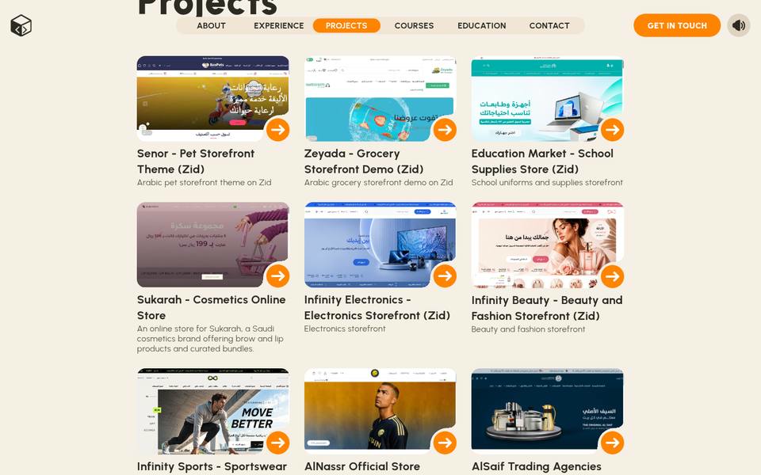
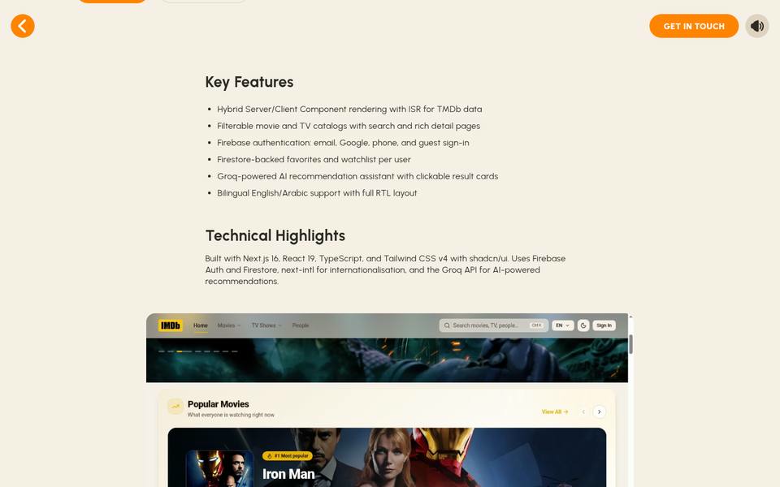
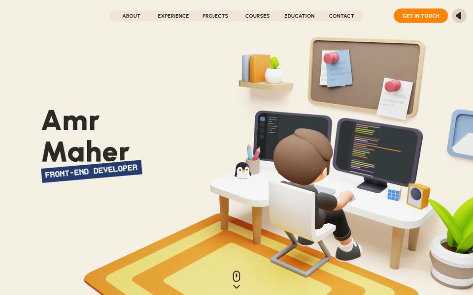
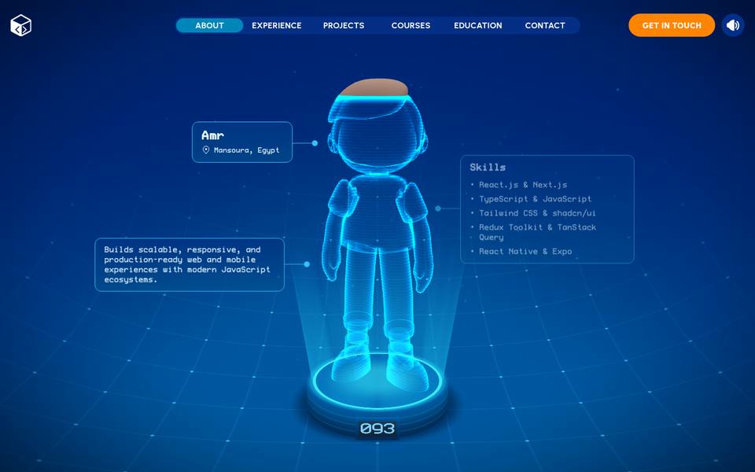

# Portfolio (2025)

Personal portfolio site with bilingual copy (English and Arabic), 27 project case studies, animated scenes, and WebGL/GLSL effects.

Built with **Vue 3**, **TypeScript**, and **Vite**. Motion via **GSAP** and **Lenis**, 3D via **three.js**, audio via **Howler**. GLSL shaders are compiled through **vite-plugin-glsl**.

## Features

- **Project case studies** - 27 projects with per-locale copy, tags, media, and links, content-driven from `src/content/projects/{en,ar}/<slug>.ts` with slugs aligned to `projectIds` in `src/content/projects/index.ts`.

  

  

- **Experience, education, and courses sections** - also content-driven (`src/content/experience`, `src/content/education`, `src/content/courses`).
- **Bilingual EN/AR** - full internationalization with a language switcher; locales defined in `src/i18n/constants` (English default, العربية), messages under `src/i18n/messages`.
- **Animated scenes** - intro, scene, and waypoint-driven transitions with GSAP and Lenis smooth scrolling (`src/animations`).

  

- **WebGL / GLSL** - custom three.js objects and shaders (`src/three`), with `.glsl`/`.vert`/`.frag` imports handled by `vite-plugin-glsl`.

  

- **Sound design** - UI sounds via Howler (`src/features/sounds`).
- **Custom UI components** - custom cursor, hologram boxes, projected elements, notch sections, and appearing-text effects (`src/components`).

## Tech Stack

| Area         | Technology                                  |
| ------------ | ------------------------------------------- |
| Framework    | Vue 3 (`<script setup>`)                    |
| Language     | TypeScript                                  |
| Build        | Vite 7 (+ `vue-tsc` typecheck)              |
| Animation    | GSAP, Lenis                                 |
| 3D / Shaders | three.js, GLSL via `vite-plugin-glsl`       |
| Audio        | Howler                                      |
| Styling      | SCSS with shared mixins (`src/assets/styles/`) |

## Scripts

| Command           | Description                               |
| ----------------- | ----------------------------------------- |
| `npm run dev`       | Dev server on port **3000** (`strictPort`)  |
| `npm run build`     | `vue-tsc` then production bundle to `dist/` |
| `npm run preview`   | Serve the production build locally          |
| `npm run typecheck` | Typecheck only (`vue-tsc -b`)               |

## Content

- **Projects**: `src/content/projects/{en,ar}/<slug>.ts` - copy, tags, media, links. Slugs must align with `projectIds` in `src/content/projects/index.ts`.
- **Previews / listing**: `src/content/projects/previews/`.
- **Tags**: variants and labels live in `src/components/tagVariants.ts` (used by `Tag.vue` and content types).

## Stack (high level)

- Vue 3 (`<script setup>`), SCSS with shared mixins (`src/assets/styles/`)
- i18n helpers under `src/i18n/`
- WebGL / GLSL under `src/three/` where applicable

## Credits & Attribution

This project was created and designed by David Heckhoff.

If you use this project or substantial parts of its source code as a base for your own portfolio or work, attribution must be preserved.

Please keep:

- existing credit comments in the source code
- this attribution section in the README
- a visible reference to the original project/repository in derivative works

Original portfolio:
-> https://david-hckh.com

Commercial reuse or redistribution of substantial portions of this project without permission is prohibited.
